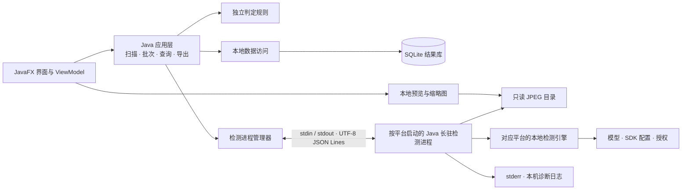

# 百度离线人脸照片检测工具详细设计

2026 年 11 月 17 日 · Java 桌面首版

桌面程序用 JavaFX 实现，在同一窗口完成 JPEG 批量检测、筛选、原图核对、人工复核和 CSV 导出。首版在 Windows x64 集成现有百度 Java 8.4 SDK，并在该平台完成正式验收。界面和 Java 业务模块可跨平台复用，本地检测引擎由独立 Java 进程按平台加载，为后续适配 MacBook 保留边界。质量结论用于判断照片是否适合作为后续人脸识别的输入，原始抓拍记录中的识别状态、`rec` 和 `live` 保留供排查。

- [百度离线人脸照片检测工具总体方案](百度离线人脸照片检测工具总体方案.md)
- [百度离线人脸照片检测工具交互原型](百度离线人脸照片检测工具交互原型.html)

## 1. 首版范围

- 首版交付与验收平台为 Windows x64。选择目录、查看进度、筛选与复核沿用 HTML 原型的布局和用语。macOS 作为后续适配平台。
- 检测范围为 JPEG 静态图的人脸数量、尺寸、完整性、姿态、清晰度、遮挡和光照。活体复测、身份比对、底库管理和历史未识别归因作为后续范围。
- 本机服务与局域网版可复用检测进程协议和规则层，首版实现 JavaFX 桌面程序。
- 开发可使用可控的检测进程替身覆盖界面和异常流程。正式程序启动时读取本地引擎状态，导出时写入实际规则版本、引擎标识和版本。授权、空返回语义、模型加载和光照量程的目标机实测是进入质量校准的前置条件。

## 2. 技术架构



| 模块 | 技术与职责 | 边界 |
| --- | --- | --- |
| 桌面界面 | Java 21、JavaFX 21。FXML 和 CSS 实现主窗口与弹窗，JavaFX 属性绑定筛选、选中项和进度 | JavaFX Application Thread 更新界面。目录扫描、图片解码、数据库和子进程通信均在后台执行 |
| 应用层 | 批次协调、文件清单、进程管理、规则发布、查询和 CSV 导出 | 统一维护批次状态，对界面提供结构化数据和命令。通过检测进程接口接入 JNI |
| 规则层 | Java 纯函数接收原始指标和不可变规则版本，输出检测状态、命中原因和证据 | 判定结果可重算。规则层不访问磁盘、SQLite 或 SDK |
| 数据访问 | Xerial `sqlite-jdbc`，本机 SQLite，单写入队列和独立读连接 | 原始测量、自动判定和人工复核分别存储。只向界面发布已提交结果 |
| 检测进程 | 单进程内保持一个本地引擎实例，串行处理请求。Windows 适配器暂用已验证可编译 SDK 示例的 Java 11 x64，macOS 适配器按实际引擎的运行依赖确定 | 从本地原图读取字节，返回可复用的测量值或结构化错误。批次、规则、复核由桌面 Java 应用管理 |

### 2.1 Java 工程

采用 Maven 多模块工程。桌面应用目标为 Java 21，Windows Worker 和共用协议模块以 Java 11 字节码为基线，以便与现有 SDK 验证环境兼容。通过构建配置固定 JDK、JavaFX、SQLite JDBC 和协议解析库版本。Windows Worker 使用单独的运行时和类路径，装有 DLL 的 SDK 依赖仅进入对应 Worker 构建。

| Maven 模块 | 内容与依赖 |
| --- | --- |
| `desktop` | JavaFX 页面、ViewModel、程序装配、系统目录、进程管理和 JDBC 实现。依赖 `core` 与 `detector-protocol` |
| `core` | 批次协调、文件清单、规则、筛选、复核和 CSV。通过接口调用检测和存储，便于用测试数据验收 |
| `detector-protocol` | 版本化消息、指标结构与故障代码。共用测试样例覆盖请求和响应序列化 |
| `detector-baidu-windows` | 接入随包百度 JNI 及 OpenCV 3.2，实现 Windows 本地 Worker。依赖 `detector-protocol` |
| macOS Worker 模块 | 随本地引擎落实后加入，依赖相同协议。引擎配置、授权、原生库及适配代码按平台装配 |

### 2.2 后续 MacBook 适配

后续启动适配时，按实际 MacBook 的 macOS 版本和 CPU 架构确认 JVM、本地 SDK、授权和质量接口。Apple Silicon 使用 `arm64`，Intel 机型使用 `x86_64`。现有 ZIP 包提供 Windows DLL，macOS 检测引擎在该阶段选型。[百度人脸离线识别 SDK 产品页](https://cloud.baidu.com/product/faceSDK)

程序按操作系统及 CPU 架构查找已部署 Worker。启动检查发现未配置时在进度区显示「本机检测引擎未就绪」，保留已有结果的查看与导出。后续接入 macOS 引擎时复用同一原型和协议，对必检指标的可用性、数值定义及阈值独立校准。检测引擎身份随测量和导出记录。

## 3. 界面与交互

### 3.1 主窗口

沿用原型的浅色桌面工具布局。顶栏保留应用名和「检测设置」，主区标题为「照片检测」，右上角为「导出 CSV」。正文使用系统界面字体、常规控件和单一强调色。不同状态同时使用短标签和颜色，键盘焦点可见。宽度不足时先收紧间距和次要列，保留左侧日期、中间列表、右侧详情的相对顺序。缺省选中当前页第一张，空结果显示简明提示。

| 区域 | 控件 | 行为 |
| --- | --- | --- |
| 抓拍日期 | 「全部日期」及各日期，右侧显示张数 | 左栏张数来自当前批次扫描清单，日期从近到远，「无日期」置底。切换日期保留状态和搜索词，原因恢复为「全部原因」，列表回到第一页 |
| 目录与进度 | 当前目录、「选择目录」、批次主按钮、进度与张数 | 原型中的主按钮按状态显示「开始检测」「取消检测」「继续检测」「重新检测」或「重试检测」。扫描、授权检查及异常信息在此区域短句展示 |
| 状态统计 | 「已检测」「合格」「不合格」「待复核」「检测失败」 | 统计当前日期范围的自动结果。点击状态卡片切换列表筛选，「已检测」包含四种自动状态。原因和搜索条件只收窄列表 |
| 检测结果 | 原因下拉、「搜索文件名」、照片、文件名、状态、原因、分页 | 日期、自动状态、原因和搜索条件取交集。关键字按大小写不敏感的子串匹配文件名，可直接搜 `rec0` 或 `live96`。文件名单元格第二行显示有效日期和时间。原因过长时可悬停查看，详情展示完整原因 |
| 照片详情 | 上一张、下一张、原图、「显示人脸框」、尺寸、状态、检测项／测量值／阈值 | 选行即更新。上下张按当前查询顺序浏览，可跨页。人脸框默认显示，在无坐标时禁用开关。抓拍记录折叠，展开可查看相对路径、原始抓拍字段、各部位遮挡值、规则版本和失败阶段／错误码 |
| 详情底部 | 「人工复核」和当前复核摘要 | 保存后即时刷新复核摘要。左侧统计、列表状态及颜色继续由自动检测结果驱动 |

列表排序同原型的日期分组方式，按日期倒序、组内按抓拍时间升序，再以相对路径稳定排序。没有合法抓拍时间的照片放在同组有时间记录之后。分页数量按可见行数确定，排序、选中和跨页规则固定。展示缩略图和详情时分别按目标像素解码，使用有上限的内存缓存，不随批次预加载全部原图。

### 3.2 四个弹窗

| 弹窗 | 保留的交互 | 落地细节 |
| --- | --- | --- |
| 检测设置 | 人脸宽高、姿态角绝对值、模糊度、各部位遮挡、光照；「恢复默认值」「应用并重新判定」 | 显示当前规则版本及比较符号。尺寸和角度使用整数，分值按两位小数录入。恢复默认值先回填表单，提交后生效。研发替身可复现授权故障，正式界面展示实际故障 |
| 人工复核 | 文件名、结论、备注；「保存复核」 | 结论为未复核、合格、不合格或待复核，备注选填且最多 300 字。可只记录备注。结论回到未复核且备注为空时清除当前意见。保存目标绑定打开弹窗时的照片内容版本 |
| 原因统计 | 原因、命中张数 | 以当前日期范围全部已检测照片为基数，按命中张数倒序，同数按名称稳定排序。一张照片可命中多项，每个原因对同一照片计一次 |
| 导出 CSV | 范围、内容和预计张数；「导出」 | 范围为当前筛选或全部已检测。内容为照片明细、按日期汇总、按日期和原因汇总。确认范围后用 JavaFX `FileChooser` 打开系统保存对话框 |

原型的「演示模式」、内置样本和授权模拟开关用于交互演示。正式程序首开无历史时显示未选择目录和空列表，选择已有批次的目录时恢复该目录最近批次。主界面仅保留上述操作入口和就地错误提示。

## 4. 批次与文件处理

### 4.1 扫描和照片标识

1. 用 JavaFX `DirectoryChooser` 打开系统目录选择器，后台用 Java NIO 递归枚举扩展名为 `.jpg` 或 `.jpeg` 的普通文件，扩展名大小写不敏感。跳过符号链接和 Windows 目录联接点，避免路径循环和越出根目录。记录无法访问的目录数量，在进度区提示扫描覆盖范围。根目录不可读时保留当前界面并提示重新选择。
2. 相对路径统一用 `/` 保存，保留实际文件名的字形与大小写，路径身份遵循所在文件系统的实际语义。扫描清单按根目录与相对路径去重。供 Worker 读取的绝对路径由协调层从清单解析，验证最终路径在根目录内。源 JPEG 以只读方式打开。
3. 在文件的祖先目录中，从近到远识别首个合法的 `yyyy-MM-dd` 日期，所选根目录也参与识别。文件名按 `HHmmss_原始状态_rec整数_live整数.jpg` 解析。日期、时间和字段分别验证，不识别的值存空，照片仍可检测。
4. Worker 对本次实际解码的 JPEG 字节计算 SHA-256，并随测量结果回传。文件的内容版本由根目录内相对路径和 SHA-256 确定。尺寸、修改时间可用于检查文件变化，复用确认以内容哈希为准。
5. 扫描结束形成当前批次清单。续跑沿用此清单，新增加的照片在重新检测时纳入。已列入清单而后续消失的照片保留原条目，处理时标记文件不存在，维持总数可核对。

### 4.2 状态流转

| 状态 | 用户看到的主要信息 | 进入与退出条件 |
| --- | --- | --- |
| 未选择／扫描中 | 选择目录或扫描进度 | 选择新目录后扫描。空目录提示没有 JPEG，开始按钮禁用 |
| 就绪 | 等待检测、`0 / N 张` | 扫描成功。点击「开始检测」进入启动检查 |
| 启动检查 | 正在检查 SDK | 初始化、授权、模型和探针通过后进入检测中。批次问题进入检测暂停 |
| 检测中 | `已提交结果 / 清单总数`、「取消检测」 | 按清单逐张提交，允许浏览和复核已提交结果。用户取消或出现批次级错误时停止派发新文件 |
| 正在取消 | 正在取消 | 给当前调用一个有限回收窗口。返回的有效结果可以提交，超时则终止该 Worker 并将尚未提交的照片归回待处理 |
| 已取消 | 已取消，可继续 | 「继续检测」复查 Worker 配置和已有结果的内容标识，再处理剩余项或变化项 |
| 检测暂停 | 简短错误、必要的错误码、「重试检测」 | 系统性阻塞时保存批次。修复后重新进行启动检查，随后继续当前批次 |
| 检测完成 | 检测完成、「重新检测」 | 每张清单照片有一个已提交结果。重新检测创建新批次、重新扫描并重新测量，历史批次按目录保存在结果库 |

批次执行规则如下。

- 每个批次仅有一个调度器，Worker 同时只处理一张图。应用将条目标为处理中并发行本次请求编号。收到匹配的响应后，在一个事务内写入内容版本、测量值、判定、原因和条目完成状态。进度在提交后更新。批次级故障和取消超时不生成虚假的逐图结果。
- 应用重启时，将上次运行中且未提交结果的条目恢复为待处理。若整个批次停在运行态，则显示可继续。已完成结果可继续查看。旧进程、旧请求和重复回包无法覆盖新提交。
- 续跑复用条件为相同根目录和相对路径、当前内容 SHA-256 一致、测量配置指纹一致、结果可复用。哈希检查在后台进行。配置或内容变化时在同一事务内撤下受影响条目的当前结果指针并重入队，历史测量仍可追溯。临时读图错误、超时和进程异常在续跑检查中重新入队。稳定的解码失败可在文件内容及解码版本一致时复用。
- 阈值、完整性规则和复核区间的变化只重判保存的测量值。引擎、原生库、模型、生效配置、解码或适配器版本变化时重新测量。人工复核绑定照片内容版本，同一字节内容随重新检测或阈值变化保留。源文件被替换时，新内容的复核从未复核开始。
- 进度总数来自清单。进度分子为四种自动状态合计，含逐图检测失败。扫描期间禁用导出，收集到首条有效提交后可导出已完成部分。取消或暂停后仍可复核和导出已提交部分。

## 5. Java 检测进程与协议

### 5.1 Windows 百度 SDK 初始化与测量

1. 应用以绝对路径启动部署目录中的 `java.exe`，明确设置 SDK 工作目录、classpath、`java.library.path` 和子进程的 `PATH`。运行目录包含配套 JAR、DLL、模型及授权。按随包手册将 `conf` 内容部署至生效目录 `config`，并验证 SDK 读取的是该目录。以 SDK 版本和实际部署的 JAR、DLL、模型、生效配置、适配器及解码版本生成测量配置指纹。该指纹在一次 Worker 会话中固定，升级在停止 Worker 后进行。进程重启后若指纹改变，按续跑规则重新校验当前批次后再派发。
2. Worker 调用 `sdkInit` 和 `isAuth()`，两项分别为 0 和 `true` 后进入探针校验。用版本锁定的已知单脸、无脸样图验证检测可用性，核对必需质量接口可返回有效字段。双脸、损坏图、小脸、贴边图及明暗对照作为首次集成和每次 SDK 配置变更的验证集。
3. 随包 `detect.json` 的 `max_detect_num` 为 10、`min_face_size` 为 0。首版先保留这两个设置，在目标机实测可检出多张人脸及低于 100 px 的小脸后锁定生效文件。算法最小检出尺寸独立于业务合格尺寸。
4. Worker 按 Unicode 路径读取 JPEG 字节，计算 SHA-256，用随包 OpenCV `imdecode` 解码成三通道图。解码时显式关闭 OpenCV 自动方向处理，再按 JPEG EXIF 方向归一化。JavaFX 预览使用存储的方向值并应用等价变换。缺省方向为 1。分别记录 JPEG 解码原始宽高和归一化后宽高，尺寸规则和脸框以归一化图像左上角为原点，坐标单位为像素。验收覆盖旋转和镜像方向。
5. 用 `Face.detect(matAddr, 0)` 对可见光图检测。包内 `FaceBox` 返回中心点和宽高，转换为 `x = centerx - width / 2`、`y = centery - height / 2`。保存浮点原始坐标和置信度，画框时裁到显示区域，完整性判断使用原始未裁剪坐标。
6. 检测到零张或多张脸时返回人数和可用框，质量细项为未执行。检出一张时调用 `faceHeadPose`、`faceBlur`、`faceOcclusion` 和 `faceIllumination`。以字段名映射姿态、遮挡，并校验数组基数、有限值、量程和单脸对应关系。单项缺失需带测量项及缺失原因。SDK 的无脸表示从目标机验证矩阵取得，未确认的空返回按检测失败处理。
7. 所有临时 `Mat`、字节容器和预览文件流及时释放。正常关闭时等待当前调用结束，调用 `sdkDestroy()` 后退出。若 JNI 卡死，由父进程负责限时回收子进程。

接口签名取自 SDK 包内 `Face.java`、`FaceBox.java`、`HeadPose.java`、`Occlusion.java`，质量字段见包内 V8.4 用户接入文档第 9.12 节。已确认的初始化记录为 `-1022 (NETWORK_ERROR)`、`isAuth() == false`，目标机是否已绑定有效离线授权仍需实测。

### 5.2 进程通信

父进程使用 `ProcessBuilder` 传递独立参数和平台工作目录，通过 stdin 发请求，Worker 通过 stdout 回一行 JSON，使用 UTF-8、无 BOM、换行分帧。协议字段为 `v`、`channel`、`id`、`op`，回复附 `ok` 和 `data` 或 `error`。文件路径只出现在本机请求中，诊断日志用短请求编号关联。约定的消息结构如下，数值为接口示例。

```json
{"v":1,"channel":"face.worker","id":"42","op":"measure","args":{"path":"D:\\FaceCapture\\2026-11-17\\090402_未识别_rec0_live97.jpg"}}
{"v":1,"channel":"face.worker","id":"42","op":"measure","ok":true,"data":{"sha256":"aaaaaaaaaaaaaaaaaaaaaaaaaaaaaaaaaaaaaaaaaaaaaaaaaaaaaaaaaaaaaaaa","image":{"sourceWidth":640,"sourceHeight":480,"width":640,"height":480,"orientation":1},"faceCount":1,"boxes":[{"x":9,"y":129,"width":209,"height":253,"score":0.96}],"pose":{"yaw":28,"pitch":7,"roll":-3},"blur":0.31,"occlusion":{"leftEye":0.12,"rightEye":0.11,"nose":0.08,"mouth":0.15,"leftCheek":0.13,"rightCheek":0.16,"chin":0.17},"illumination":0.36,"missing":[],"durationMs":91}}
{"v":1,"channel":"face.worker","id":"43","op":"initialize","ok":false,"error":{"scope":"batch","stage":"initialize","code":"SDK_INIT_FAILED","nativeCode":-1022,"retryable":true}}
```

| 操作 | 请求内容 | 成功响应 | 使用时机 |
| --- | --- | --- | --- |
| `initialize` | 协议版本和本次运行配置标识 | 引擎标识及版本、测量配置指纹、指标语义版本、授权状态、探针结果、能力列表 | 每次启动或恢复进程后。授权失败或必检能力缺失返回批次级错误 |
| `measure` | 当前图片绝对路径 | SHA-256、方向及尺寸、人脸框和数量、原始指标、缺失项、耗时 | 完成初始化后逐图调用。JSON 数值采用有限值，未测量字段使用 `null` 并附原因 |
| `shutdown` | 无 | 释放状态 | 正常退出时，在当前检测调用结束后发送 |

应用日志和 Java 可控日志输出至 stderr。父进程异步持续读取两路输出，仅接受协议版本、操作名及请求编号匹配的标准输出行。SDK DLL 如果直接写入 stdout，独立的非协议行按诊断处理。目标机须验证 SDK 日志与 JSON 行的隔离。若交错，先在进程入口隔离原生日志句柄再重新验收。协议帧损坏、超长或关联错误按进程异常处理。进程代次和请求编号成对关联，迟到响应丢弃。

各平台适配器统一输出协议约定的方向、像素坐标、姿态轴和量纲。规则版本声明适用的引擎标识及指标语义版本，选择规则时先校验匹配关系。引擎缺失某项能力属于启动检查问题。已声明有该能力、单张图片偶发缺值时按指标缺失处理。

### 5.3 故障分级

错误响应统一包含 `scope`、`stage`、`code`、可选 `nativeCode` 和 `retryable`。进程内错误范围为 `file` 或 `batch`，进程退出和协议故障由父进程归类。文件已读取但解码失败时附内容哈希，以支持续跑。界面用简明中文显示，详情保留阶段和错误码。

| 范围 | 例子 | 应用行为 |
| --- | --- | --- |
| 指标级 | 单脸时光照数组为空、某个姿态角无有效数值 | 记入 `missing`，保留已取得的指标，按规则汇总不合格或待复核 |
| 照片级 | `FILE_NOT_FOUND`、`FILE_READ_FAILED`、`JPEG_DECODE_FAILED`、经健康检查确认可隔离的 SDK 调用异常 | 落一条「检测失败」，记录可用尺寸、阶段和错误码，再处理下一张 |
| 批次级 | `ENGINE_UNAVAILABLE`、`SDK_INIT_FAILED`、授权检查失败、模型加载失败、探针不可用、缺少必检能力、数据库写入失败 | 暂停批次，保留已提交记录。修复后通过「重试检测」恢复 |
| 进程级 | `WORKER_EXIT`、`WORKER_TIMEOUT`、`PROTOCOL_ERROR` | 回收子进程，重启并通过探针后对当前照片重试一次。若再次失败且另一进程能通过独立探针，则记录逐图失败并继续。探针失败或连续两张不同照片均触发同类进程故障时暂停整批 |

初始化、单图调用、取消回收和退出分别设置有限超时。开发暂用 60 秒、30 秒、2 秒和 5 秒，目标机以断网初始化耗时、单图 P95 和超时样本校准。超时后保持原请求身份直到清理结束，避免重复提交。

## 6. 判定规则

| 检查项 | 首次试跑条件 | 输出证据与原因 |
| --- | --- | --- |
| 人脸数量 | 恰好 1 张 | 零张或多张时直接不合格，证据为检测人数。其余项目显示「未执行」 |
| 人脸尺寸 | 宽、高均 ≥ 100 px | 逐维比较原始浮点值，显示宽、高及低于阈值的尺寸 |
| 完整性 | 人脸完整入画 | 以 `[0, W] × [0, H]` 表示像素框的连续外边界，边距取 `min(x, y, W - x - width, H - y - height)`。负边距表示框越界。用样图确认检出框的裁剪行为后，按校准配置判断是否已有充分的出画证据。贴边或越界证据不足时待复核 |
| 姿态 | 左右偏转、俯仰、倾斜各取绝对值 ≤ 15° | 保留有符号的 yaw、pitch、roll，详情按此顺序显示并指出超限轴 |
| 模糊度 | ≤ 0.60 | 记录原始值及阈值，超限原因为「照片模糊」 |
| 局部遮挡 | 双眼、鼻、口、双颊、下巴各 ≤ 0.60 | 主表展示最高部位及数值，展开可见全部七个数值。原因统计按「局部遮挡」每张计一次 |
| 光照 | ≥ 0.60，目标机实测确认量程与方向后启用 | 低值原因为「面部偏暗」，缺失单独标记。逆光、强高光和阴阳光需独立证据，首版采用已校准规则 |

表中数值用于现有百度 Windows SDK 的首次试跑。未来适配 macOS 引擎时，按引擎版本和指标语义重新校准规则。

必检项按以下次序汇总。

1. 无法建立有效检测上下文或文件无法解码时按故障范围处理。确认无脸或多脸时，按数量规则输出不合格。
2. 对单脸收集全部可靠证据。存在已确认的不合格项时输出「不合格」，同时保留待复核原因。没有已确认的不合格项且存在贴边、校准后的临界区间或必检指标缺失时输出「待复核」。
3. 所有启用的必检项均有有效结果且通过时输出「合格」。等于阈值时按表中包含等号的关系判断。临界复核区间由校准配置启用，初始配置为空，启用后单独记录上下界与开闭区间。

原因通过稳定代码查询和统计，例如 `FACE_NONE`、`FACE_MULTIPLE`、`FACE_TOO_SMALL`、`FACE_OUTSIDE`、`FACE_EDGE`、`POSE_LIMIT`、`BLUR_LIMIT`、`OCCLUSION_LIMIT`、`LIGHT_LOW`、`METRIC_MISSING`。详情保存触发部位、实测值、比较符、阈值和缺失项等证据。参与判定的是原始精度，取整和小数格式只用于展示，临界情况下详情增加足够的小数位解释结论。

## 7. 数据模型与一致性

每个系统用户使用本机结果库。Windows 放在 `%LOCALAPPDATA%\BaiduFacePhotoQuality\data\results.db`。macOS 放在 `~/Library/Application Support/BaiduFacePhotoQuality/data/results.db`。应用持有应用数据目录中的跨进程文件锁，第二实例提示程序已打开。启用外键、WAL 和有限等待时间。写入由应用层串行调度，默认以 `synchronous=FULL` 提交批次结果，目标机全量验收测量写入开销。[SQLite WAL 与提交说明](https://www.sqlite.org/wal.html) · [SQLite PRAGMA 文档](https://www.sqlite.org/pragma.html)

| 表 | 主要字段与约束 |
| --- | --- |
| `source_root` | `root_id`、规范根路径、显示路径，根路径唯一 |
| `photo` | `photo_id`、`root_id`、相对路径、日期、时间、原始状态、`rec`、`live`，根目录内相对路径唯一 |
| `photo_revision` | `revision_id`、`photo_id`、`content_sha256`、大小、记录时的修改时间，照片与哈希唯一 |
| `measurement_profile` | 指纹、引擎标识及版本、平台与架构、指标语义版本、原生库／模型／配置哈希及适配器和解码版本，指纹唯一 |
| `rule_set` | 规则版本、适用引擎与指标语义版本、阈值、启用项、完整性规则、临界区间、创建时间。版本创建后不可修改 |
| `batch` | `batch_id`、根目录、状态、当前测量配置指纹、当前规则版本、清单总数、创建和完成时间、最近批次错误 |
| `batch_item` | `item_id`、批次、照片、稳定顺序、待处理／处理中／已提交状态、当前测量指针、活动请求编号。批次内每张照片唯一 |
| `measurement` | `measurement_id`、所属条目、可空内容版本、配置指纹、图像方向及尺寸、原始指标、脸框、诊断和耗时。成功与照片级失败均记录，测量记录只追加 |
| `decision` | 测量、规则版本、自动状态、计算时间。每个测量与规则版本组合唯一 |
| `decision_reason` | 判定、原因代码、顺序、证据 JSON。每个原因在同一判定中唯一，多个部位证据写在该原因下 |
| `manual_review` | 照片内容版本、可空人工结论、备注、更新时间。每个内容版本一条当前意见 |

按 `batch_item(batch_id, state, sort_order)`、`photo(root_id, capture_date)`、`decision(rule_set_id, status)` 和 `decision_reason(code, decision_id)` 建立查询索引。字段稳定的查询使用列，脸框、原始指标及证据结构可用带版本号的 JSON 保存。读图失败而无法确认内容哈希时，详情仍可查看诊断，人工复核待照片内容版本可确定后可用。

规则应用作为写入队列中的顺序操作。事务内写入新规则、重判当前批次所有已提交测量、更新批次规则指针和下次新建批次的默认规则。事务提交后再刷新列表和统计，刷新后尝试保留仍符合筛选的选中项。若检测正在运行，后续返回的测量在新规则下提交。规则事务失败时界面继续显示旧版本，批次可按旧规则继续。

目录和筛选切换采用新的查询代次，迟到的分页或缩略图响应只在匹配当前查询时应用。结果列表与「当前筛选」导出共用筛选和排序定义，统计卡片与原因统计共用日期范围定义。主窗口一次刷新读自同一数据库快照，自动判定从批次规则版本和当前测量指针关联取得。

## 8. 预览、CSV 与运行数据

### 8.1 预览与原图保护

预览以等比缩放居中显示。若原图为 `W × H`、预览区域为 `Vw × Vh`，比例取 `s = min(Vw/W, Vh/H)`，居中偏移由余下宽高各除以 2 得到。框和图片使用同一变换，图片文件始终只读。选中详情时以实际读取的字节对照存储哈希，发现文件变更或不可读时提示原图已变化或不可用，并隐藏旧框。JavaFX 用 `ImageView` 显示图像，在同一容器覆盖人脸框。

### 8.2 导出格式

导出开始时用 SQLite 读事务固定范围、规则版本和人工复核快照，生成文件期间批次仍可运行。默认使用 UTF-8 BOM 和 CRLF，字符串按 CSV 规则转义，在 Windows 验证中文列的读取。用户输入的文本列按表格公式注入规则转为文本，真实数值列按不依赖系统区域设置的数值输出。临时文件写在目标目录，成功后再替换或移动到目标文件名。失败后清理本次临时文件并保留原目标文件。

| 类型 | 字段与校核 |
| --- | --- |
| 照片明细 | 相对路径、抓拍日期与时间、原始宽高、归一化宽高及方向、原始状态、`rec`、`live`、自动状态、全部原因及证据、人数、人脸框、姿态、模糊度、各部位遮挡、光照、完整性、原始值缺失原因、规则版本及阈值、引擎标识与版本、测量配置指纹、失败阶段及异常码、人工结论和备注。未测字段为空，合法的零保留 |
| 按日期汇总 | 日期、已检测、合格、不合格、待复核、检测失败。单行四种状态之和等于该日期已检测数，全部日期相加等于所选范围张数 |
| 按日期和原因汇总 | 日期、原因、命中张数。按照片与原因去重，一图多因分别计数。没有命中原因的日期可列为「无异常原因」，张数为 0 |

界面上的预计张数在实际导出时以启动读事务的快照为准，完成提示显示实际导出范围和张数。导出内容不包含绝对根目录、授权文件、设备指纹或照片二进制数据。

### 8.3 部署与诊断

- 用 `jpackage` 在各目标系统构建并附带桌面运行时。Windows x64 生成应用镜像和安装包，包含独立的 Java 11 x64 Worker 运行时、配套 OpenCV、SDK DLL 和模型。实际需安装的 VC++ 运行库由目标机依赖检查确认。Windows 授权文件按百度要求在目标机单独部署。[Oracle JDK 21 打包说明](https://docs.oracle.com/en/java/javase/21/jpackage/packaging-overview.html)
- 后续 macOS 发布时，按目标 CPU 架构构建 `.app` 和 `.dmg`，运行时、JavaFX、SQLite JDBC 原生库和本地引擎使用匹配架构。届时验证 Developer ID 签名、公证、JDBC 原生库加载和 Worker 启动。授权文件和可写设置放在应用包外的用户数据目录。[JavaFX 21 平台说明](https://openjfx.io/highlights/21/) · [Apple macOS 分发说明](https://developer.apple.com/macos/distribution) · [Xerial SQLite JDBC 加载说明](https://github.com/xerial/sqlite-jdbc/blob/master/USAGE.md)
- 用户可写数据目录存放数据库、用户设置和轮转日志。数据库升级执行版本化迁移，迁移前使用 SQLite 备份接口生成一致备份。原图目录不写入应用数据库、缩略图、配置或日志。
- 应用日志记录批次或请求编号、时间、组件、阶段、错误码和耗时，不输出授权内容、设备指纹或原始图像字节。调试时使用脱敏的相对路径。错误提示示例为「SDK 初始化失败（-1022）。请检查授权后重试。」和「照片解码失败」。

## 9. 实施与验收

本节所有实施验收均在 Windows x64 目标电脑上完成。

| 顺序 | 实施内容 | 验收依据 |
| --- | --- | --- |
| 1 | 目标机 SDK 验证与 Worker 协议 | 核对 Windows、JDK、DLL 依赖，在断网条件下通过初始化和探针。用约 20–30 张现场图及无脸、双脸、小脸、坏图、EXIF 方向样本核对返回语义、原始值、光照量程、框的位置与协议日志 |
| 2 | 批次协调、SQLite 和规则层 | 能扫描中文目录并逐图提交。验证同路径内容替换、文件删除、配置变化、停止进程与重启续跑、重复回包、数据库写入失败和规则重判的一致性 |
| 3 | 按原型实现并验证 JavaFX | 在 Windows 逐项验收主窗口、日期列表、统计卡片、筛选分页、上下张、框开关、折叠明细及四个弹窗。检查键盘操作和显示缩放，验证目录访问、中文路径、SQLite 和 CSV |
| 4 | 质量校准与规则锁定 | 按日期、光照和姿态抽取约 150–250 张人工标注，将相近的连续抓拍放在同一数据分组，用留出样本核对误放、误拦、待复核比率以及原因命中情况，确认后冻结规则和 SDK 配置 |
| 5 | Windows 全量验收 | 在目标机断网状态下运行当前 4,022 张 JPEG 并导出三类 CSV，四种自动状态合计等于 4,022。抽验逐图结果、失败原因及人工复核保留，核对 CSV 与界面数量，测试取消续跑、规则重判与重复运行，记录总耗时、单张 P50／P95 和进程峰值内存 |

目标机授权与 SDK 实测通过后才录入生产版本的检测参数。首次上线将生产规则版本、测量配置指纹、应用版本及全量验收结果一同记录，供现场复核和后续升级对照。
